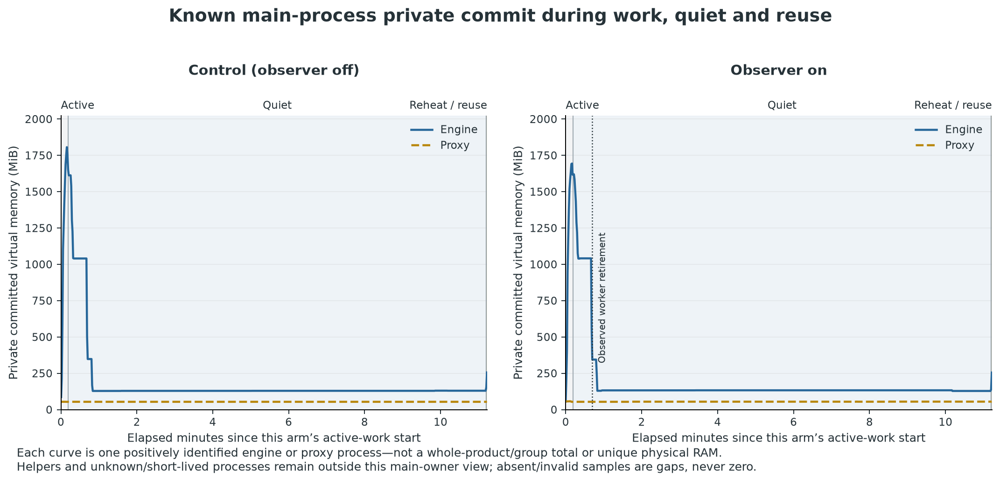
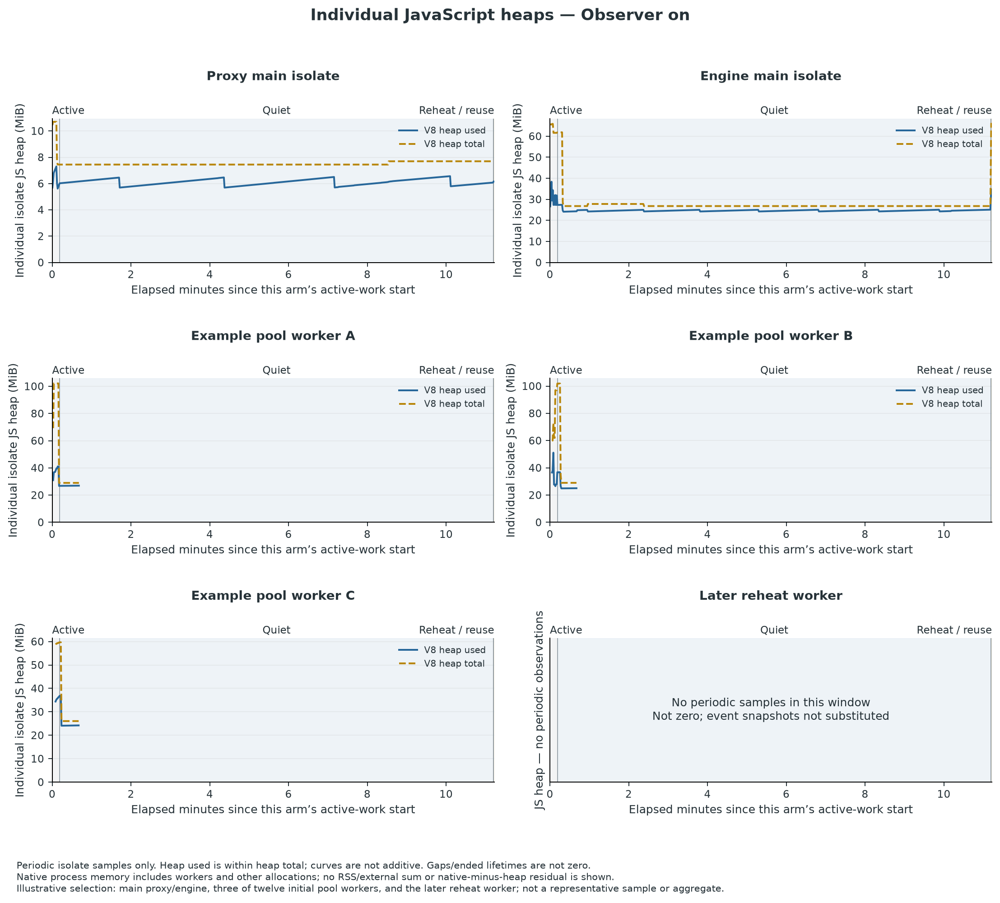
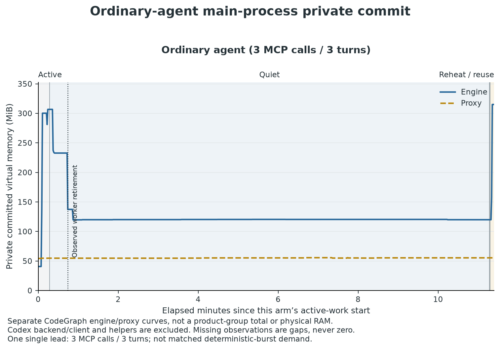
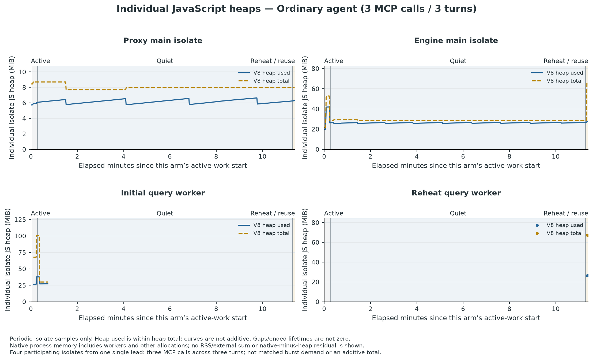

# Installed CodeGraph memory during agent work and quiet periods

**Research report — 2026-10-23. Actual-agent and deterministic-companion evidence assembled. Integrated-review and map-driver acceptance disposition: section 7.**

Question: [Attribute CodeGraph memory during agent work and quiet periods](https://github.com/MECHLESIA/codegraph/issues/47), within [Reduce installed CodeGraph RAM without sacrificing results or uncapped concurrency](https://github.com/MECHLESIA/codegraph/issues/41). This report supplies evidence to [Choose genuine RAM optimizations for installed CodeGraph](https://github.com/MECHLESIA/codegraph/issues/45); it does not select or implement an optimization.

## 1. Answer and present evidence boundary

For the measured deterministic burst, **the engine process, including its worker threads, is the main active owner—not the saved proxy**. Its sampled active private-commit maximum was 1,806.47 MiB without the observer and 1,693.98 MiB with it, versus proxy maxima of 54.34 and 57.82 MiB. These are separate individual main-owner observations, not whole-product totals, exact continuous peaks or an observer savings result.

In the observer arm, **all twelve initial query workers actually exited and joined near their existing idle boundary**; a later sample of the same pool was empty. Engine private-commit five-sample medians around the last exit changed from 1,041.14 to 344.40 MiB, then a later sample was 129.80 MiB. The transition accompanies genuine retirement but is not instantaneous, exclusively per-worker, or proven to be a particular GC/allocator mechanism. Near 600 seconds, the project writer/coordinator reader really closed; the accompanying five-sample private-commit median change was much smaller, about 4.59 MiB. The engine then remained around 128–130 MiB and proxy around 54–55 MiB.

The separate **actual ordinary-agent arm completed three turns and three read-only CodeGraph calls**. It exercised one initial query worker, which really exited/joined during connected quiet; reheat on the same engine opened a new reader/worker, and that worker later retired too. Its engine PB median was 120.37 MiB in quiet 35–600 seconds and 119.89 MiB in the late first-quiet window. A later, shorter 60-second post-reheat quiet had median 174.48 MiB: it is not the same equilibrium or duration as the first 660-second quiet. One lead's serial demand is not the twelve-arrival companion or a multi-agent fleet.

**This is bounded owner/lifetime attribution, not a complete allocator partition.** It contradicts indefinite retention of the observed query workers and separates early worker-associated footprint from the later cached-handle boundary. It does not label the remaining native memory SQLite, WASM, ASTs or a leak. Actual-agent and companion findings remain separate; final integrated review and acceptance are recorded separately in section 7.

| Decision-facing question | Measured disposition | Remaining boundary |
|---|---|---|
| Which processes, isolates, readers and writers actually participated? | Main engine/proxy owners identified; twelve initial companion workers versus one initial agent worker, plus distinct reheat workers and actual reader/writer boundaries. | Client/capture actors excluded; product-helper whole-lifetime coverage incomplete. A known-main view is not the whole product. |
| What private commitment, private residency and total residency persisted into quiet? | Separate individual main-owner ledgers in sections 5.2 and 5.5. Late first-quiet engine PB medians about 128–130 MiB for the companion and 119.89 MiB for the agent. | Different demand/state windows, not a savings comparison; WS/private WS differ and no unique physical-RAM claim is made. |
| Did query workers retire while the same engine remained connected? | **Yes in both observed treatments:** actual exit/join followed by empty-pool evidence. Actual-agent reheat used the same engine/session/generation and a new reader/worker. | Not merely timer constants; hooked lifecycle proof is not extended to the uninstrumented control or every configuration. |
| Which allocation categories explain the remaining footprint? | Periodic main/worker JS heap evidence narrows owner/category. **Exact remaining native partition unresolved.** | Current counters do not measure SQLite cache occupancy, object retainers or a complete native allocation partition. |
| Did instrumentation alter answers, work or timing? | Same 138 semantic core inputs and exact core texts; timing differences are visible, not identical. | One fixed-order pair cannot establish causal overhead, variance or a memory correction factor. |
| What does this imply for a later optimization decision? | Worker/reader/isolate multiplication and its early lifetime are material for this burst; indefinite worker retention is ruled out here. **No optimization selected.** | Exact per-owner avoidable representation and remaining SQLite/WASM/allocator/map partition remain questions only if material to the later choice. |

The report does not claim a leak, a full-desktop or multi-agent-fleet footprint, unique physical RAM, a complete accounting of every byte, or a savings percentage. It does not repeat the large accumulated indexing workload to answer an ordinary-query question. These are scope boundaries, not results suppressed from the analysis. The independently reviewed companion finding is bound to scientific review SHA256 **`886004F51EF20C0F76E2B45BF53893F7B8EBE4FDC163E1611E5954ECCF60CF3B`** and the sealed raw/reduction identities in the [evidence ledger](installed-ram-attribution-2026-10-23/evidence-ledger.md).

## 2. Source and prior-evidence identity

All product-source links pin **`3e2305c811e89b9f7a4048134d245eaa38b3a96e`**, the accepted package 1.6.2 source, rather than the current default branch. The installed-package archive identity previously accepted by this map is SHA256 **`C5FA31E70BED61FA96EDEDF2AE4A89293F4218EC72726428809F68C8E4F89651`**; bundled Node identity is **24.16.0**. The reviewed experiment separately binds the actual full-member package check and the observation-only replacements/preload. A source pin alone would not prove that a measured package matched it.

The prior decisions remain accepted within their original scope:

- [Map memory ownership and duplication in installed CodeGraph](https://github.com/MECHLESIA/codegraph/issues/42#issuecomment-6287252077) accepted the [source ownership report at `668777c6`](https://github.com/MECHLESIA/codegraph/blob/668777c6e302d35bf0b60396e30b886fd88fce06/docs/research/installed-ram-ownership-2026-10-20.md). It is a topology/lifetime map, not measured populated bytes, reclaim timing or savings.
- [Find allocation reductions that preserve CodeGraph answers and concurrency](https://github.com/MECHLESIA/codegraph/issues/43#issuecomment-6287201005) accepted the [allocation hypotheses at `00dddf57`](https://github.com/MECHLESIA/codegraph/blob/00dddf5741716fb674c92722c556ab7fa310d636/docs/research/installed-ram-allocations-2026-10-20.md). Its candidates are unmeasured hypotheses, not selected optimizations or mandatory implementations.
- [Measure installed CodeGraph memory across active and idle workloads](https://github.com/MECHLESIA/codegraph/issues/44#issuecomment-6300093245) accepted a qualified baseline. Ordinary-agent known-owner subtotals had changing membership and incomplete lifetime coverage; its direct quiet distribution was not a causal retirement measurement. Its large-index result is a separate phase-specific footprint, with the published strict resource/lifetime limitations preserved. No samples from that campaign are pooled into this report.

This campaign's exact package-copy, fixture, observer, producer and reduction identities belong in the [sanitized evidence ledger](installed-ram-attribution-2026-10-23/evidence-ledger.md). Raw process/session/configuration receipts remain private; no claim depends on publishing those sensitive contents.

## 3. Ownership model: what should be discriminated

### 3.1 Process route is an observed property

Shared daemon, direct execution and fallback are different routes. Sessions reuse an engine only when they actually attach to a compatible shared engine. Configuration intent, an executable name or a process count is insufficient to establish that route. The source constructs these alternatives in [`src/mcp/index.ts:624–722`](https://github.com/MECHLESIA/codegraph/blob/3e2305c811e89b9f7a4048134d245eaa38b3a96e/src/mcp/index.ts#L624-L722).

The final owner ledger therefore separates client/proxy from engine processes and identifies which route actually served the treatment. Collector and analysis helpers are accounted separately from product owners. A single connected session does not establish a multiplier for every session or agent on a workstation.

### 3.2 An engine contains distinct owners, not necessarily full graph copies

The coordinator opens a read-only graph; the writer is a separate optional graph; query workers open their own readers/handlers. These are distinct facade/connection owners even when they refer to the same project database. The `CodeGraph` constructor wires multiple layers, but layer construction is not proof of fully populated graph/cache representations. See [coordinator reader](https://github.com/MECHLESIA/codegraph/blob/3e2305c811e89b9f7a4048134d245eaa38b3a96e/src/mcp/project-lifecycle.ts#L305-L334), [writer](https://github.com/MECHLESIA/codegraph/blob/3e2305c811e89b9f7a4048134d245eaa38b3a96e/src/mcp/project-lifecycle.ts#L493-L538), [worker reader](https://github.com/MECHLESIA/codegraph/blob/3e2305c811e89b9f7a4048134d245eaa38b3a96e/src/mcp/query-worker.ts#L46-L82) and [facade layers](https://github.com/MECHLESIA/codegraph/blob/3e2305c811e89b9f7a4048134d245eaa38b3a96e/src/index.ts#L177-L247).

### 3.3 Different retirement clocks must not be conflated

Eligible idle query workers have a 30-second retirement path. Handler retention for explicit projects has a separate 600-second default/trim path, and the default graph is not an entry in that explicit-project cache. The idle-retention entry count is not an active-project concurrency cap. A retirement *request* differs from actual worker exit/termination completion; reaching a time threshold does not prove a handler trim ran. See [pool idle retirement](https://github.com/MECHLESIA/codegraph/blob/3e2305c811e89b9f7a4048134d245eaa38b3a96e/src/mcp/query-pool.ts#L399-L435), [exit/join accounting](https://github.com/MECHLESIA/codegraph/blob/3e2305c811e89b9f7a4048134d245eaa38b3a96e/src/mcp/query-pool.ts#L525-L564) and [handler trim](https://github.com/MECHLESIA/codegraph/blob/3e2305c811e89b9f7a4048134d245eaa38b3a96e/src/mcp/tools.ts#L2464-L2516).

A quiet interval longer than both thresholds makes the relevant transitions observable if they occur. It does not force them, test eviction beyond the chosen project count, or imply that the engine should exit while a client remains connected.

### 3.4 Allocation candidates must be tied to an exercised path

Possible contributors include query result/source/row temporaries, persistent readers and native database state, resolver Node/cache duplication, AST/parser/grammar state, and indexing buffer/binding overlap. Some paths are query-relevant; others require extraction or full resolution and may not execute in a stable query treatment. The [candidate-to-observable matrix](installed-ram-attribution-2026-10-23/candidate-matrix.md) binds each candidate to exact source, a necessary discriminator and the current measurement's proof limit.

## 4. Experimental design and estimands

The following describes the reviewed design. **Declared schedules are not completed-work counts.** Section 5 distinguishes actual failed/corrected canaries, the companion pair and the separate actual-agent result. The exact chosen counts and tools are measurement mechanics, not a new product capacity limit or a requirement to build a general benchmarking framework.

### 4.1 Small, fixed, disposable inputs

The treatment uses an already indexed clean CodeGraph fixture, with a separate small fixture for isolation/freshness guards. Stable source/index inputs avoid making a large indexing campaign a prerequisite for the active-to-quiet question. No production root is an input. Before each paired arm, a frozen source/index/sidecar snapshot is restored at the same disposable roots; the reset verifies the same member hashes, sizes and timestamps while task runtimes are quiescent and database files are not held open. A live database copy or a semantic-only reset is not exact initial-input equality.

Input denominators are kept distinct. The independently reviewed matched experiment preserves the reconciled full-fixture accounting: **1,610 source members**, **1,326 CLI successful files**, and **1,329 stored file rows**, comprising 1,323 positive-node files, three successful file-level-only YAML rows and three existing oversize-C warning rows; graph counts are 34,959 nodes and 112,064 edges. The small fixture has 100 source/stored/positive-node files. These are fixture provenance, not memory results. The original setup guard that equated CLI successes with stored rows remains a failed attempt; reconciliation is a distinct read-only receipt, not a relabelled original success.

### 4.2 Complementary arms

| Arm | Declared design and scientific purpose | Final execution disposition |
|---|---|---|
| Short instrumentation canary | 24 core requests and 40-second connected quiet; check route, real hook emission and semantic guards before a long arm. | Original prefix failed; corrected attempt completed 24 core plus 15 protocol/guard requests and 40.359 s quiet. Not the primary attribution result. |
| Clean deterministic companion | Pristine package, no overlay/preload/timers; six cold, six warm, 120 burst offers, 660-second connected quiet, six reheat requests. | **Reviewed bounded result:** 138 core offers/completions; native main-owner phase observations. |
| Instrumented deterministic companion | Observation-only six-file overlay plus external per-isolate preload; same initial inputs and same 138 core offers as the clean arm. | **Reviewed bounded result:** matching core work; native, worker/database lifecycle and isolate observations. |
| Actual ordinary-agent arm | One native lead agent, three offered turns with a connected quiet/reheat sequence; agent chooses read-only tool calls. Actual model/runtime/tool evidence is bound separately. | Three turns and three `codegraph_explore` calls completed; 660-second connected quiet, reheat and a separate 60-second later quiet observed. Not matched deterministic demand, a child-agent or desktop-scale test. |
| Optional native category diagnostic | Separate, explicitly perturbing point-in-time native-map capture, only if actually performed and relevant. | **NOT RUN.** Not needed for the bounded lifetime exclusions; exact native allocation partition unresolved. |

The deterministic burst offers ten waves of twelve at one-second planned monotonic offsets **independent of preceding completions**. Record actual offer times, schedule lag, terminal status, dispatch and execution overlap; client outstanding work is not executing server concurrency. Protocol initialization, guards, retries and failures are counted separately from the 138 core offers. No added admission cap, sleep-based load reduction or busy deadline is used to manufacture a smaller memory footprint.

Mutation/freshness/isolation/restoration checks occur after the principal quiet/reheat treatment. Every guard attempt remains visible, including failures before later convergence. They cannot be used as an explanation of earlier quiet memory, and a new arm starts from the frozen baseline rather than the preceding arm's mutated state.

### 4.3 Quiet and owner-lifetime definitions

Primary quiet starts after all burst terminal completions and the finite native identity snapshot. Last completion and quiet origin are separate anchors. No driver tool/status/database/debug queries or observer-added forced GC occur in the scheduled quiet window. Native identity snapshots are not CodeGraph queries. Product watchers, freshness work and maintenance may still execute: **quiet means no new offered driver work, not proved CPU or descendant inactivity**.

Join process ID with creation/incarnation evidence; also bind engine generation, isolate/thread, project/graph/database and request identities within their actual scopes. Split native group summaries when owner membership changes or an expected owner's memory row is missing. Worker replacement, request retirement, delivery settlement, execution return, actual worker exit and database close-return are different events. Same-engine reheat requires continuity evidence, not matching executable names.

A reducer flag for valid joined rows and global capture span is not proof that every expected owner was observed throughout its lifetime. The final table reports the expected owner window, positive observed rows, covered duration and gaps separately. Missing/after-exit absence is unknown, not zero. A whole-owner coverage failure restricts that claim without erasing valid narrower positive observations.

### 4.4 Separate, non-additive memory ledgers

| Ledger | Meaning used here | Limits |
|---|---|---|
| Native process private commitment | Private Bytes: private committed virtual memory for an identity-bound process; simultaneous sums only for a known fixed owner set. | Not a physical-RAM total or pagefile usage. Never sum independently occurring process peaks. |
| Native process residency | Total working set and private working set, reported separately at the same samples. | Total working sets can share pages. Their sum is not unique physical RAM. Total minus private WS is a resident-shareable residual, not deduplicated shared memory. |
| Per-isolate JS/V8 | Periodic `process.memoryUsage()` and `v8.getHeapStatistics()` values, separated from request/lifecycle event snapshots. | Worker RSS is whole-process RSS; never add it across isolates. `heapUsed` is within `heapTotal`; ArrayBuffers overlap `external`. These are not additive OS/SQLite/WASM buckets. |
| Native/map diagnostic, if completed | Captured type/file commitment and residency for a verified owner at an identified time. | A point-in-time category, not allocation-site/retainer proof, SQLite populated cache bytes, an exact transient peak or unique machine residency. |
| Work and speed | Completed/failed/cancelled/unfinished demand, semantic equality, latency, throughput, schedule lag and observed execution overlap. | Turn latency includes model/network/tool work. Equal offered work alone does not prove equal executed overlap. |

Microsoft maps [Private Bytes and working-set counters to process memory information](https://learn.microsoft.com/en-us/windows/win32/memory/memory-performance-information), defines [private commitment](https://learn.microsoft.com/en-us/windows/win32/api/psapi/ns-psapi-process_memory_counters_ex), and distinguishes [private from shared working-set pages](https://learn.microsoft.com/en-us/windows-hardware/test/wpt/memory-footprint-optimization#terminology). These definitions explain why commitment and residency must be separate ledgers rather than one RAM number.

Node's counter semantics are documented in the [Node 24.16 process API](https://github.com/nodejs/node/blob/v24.16.0/doc/api/process.md#processmemoryusage) and [V8 statistics API](https://github.com/nodejs/node/blob/v24.16.0/doc/api/v8.md#v8getheapstatistics). Report memory-valid, CPU-valid and strict joint-resource denominators separately. A missing CPU rate does not invalidate an otherwise valid memory value; a missing expected owner's memory does leave the corresponding whole-owner subtotal unknown. Sampled maxima are lower-bound observations of peaks at the capture cadence, not exact transient maxima. Byte-to-MiB/GiB conversions use powers of two and retain authoritative unrounded values in the sanitized numeric asset when supplied.

Periodic samples and event snapshots have different sampling mechanisms. Compare periodic distributions with periodic distributions; do not present a request-event-weighted active median against a periodic quiet median as a matched change. Native commitment minus V8 heap is **not a SQLite estimate**.

### 4.5 Observation mechanism and perturbation

The disposable overlay changes six compiled files at pinned source seams: engine, query pool, query worker, routed tool handler, database facade and project lifecycle. It records engine/pool binding, worker readiness and actual dispatch/return/retirement/exit, reader/writer binding and database open/close-return. An external preload supplies timestamped per-isolate periodic counters and event snapshots. The measured copy's full package-member check allows only the exact six replacements, with original and overlay hashes bound separately; the preload remains outside the product package. A patched package with telemetry disabled is not the pristine control.

Observation uses bounded output and unreferenced timers; it adds no GC request, heap snapshot, profiler, status/freshness poll, keepalive worker/socket or product capacity/lifetime-policy change. **The product's own existing teardown collection remains unchanged and may collect**, so this is not a claim of no forced GC anywhere. Synchronous metrics and record writes can perturb heap/timing; actual clean/observer comparison, not syntax or synthetic validation, establishes the measured extent of that effect. Telemetry cap/duration stops and sequence gaps restrict coverage; they must not become a zero-memory plateau.

Generic database-facade hooks do not cover all native SQLite handles. A checkpoint eval worker constructs `DatabaseSync` directly in [`db/index.ts:674–718`](https://github.com/MECHLESIA/codegraph/blob/3e2305c811e89b9f7a4048134d245eaa38b3a96e/src/db/index.ts#L674-L718); [resolver workers](https://github.com/MECHLESIA/codegraph/blob/3e2305c811e89b9f7a4048134d245eaa38b3a96e/src/resolution/resolver-worker.ts#L53-L84) and [store workers](https://github.com/MECHLESIA/codegraph/blob/3e2305c811e89b9f7a4048134d245eaa38b3a96e/src/extraction/store-worker.ts#L81-L97) use raw database construction. An inherited isolate counter does not close that per-handle/occupancy gap. There is no allocation-site, object-retainer, parser/tree-cache or SQLite cache-occupancy probe in this observer.

## 5. Verified run results

Numeric results below use this campaign's sealed actual records, not prior-campaign values, plan constants, incomplete hook prefixes or sums of independent process peaks. Their source/input/run/reduction bindings and scope limits are in the evidence ledger.

### 5.1 Attempt and work disposition

Independent review joined every offered request to its terminal event, raw response and client result record in both companion arms; the two ledgers each report zero review issues. The verified work is:

| Request group | Clean offers / completed | Observer offers / completed |
|---|---:|---:|
| Cold | 6 / 6 | 6 / 6 |
| Warm | 6 / 6 | 6 / 6 |
| Fixed burst | 120 / 120 | 120 / 120 |
| Reheat | 6 / 6 | 6 / 6 |
| **Core subtotal** | **138 / 138** | **138 / 138** |
| Protocol initialization | 4 / 4 | 4 / 4 |
| Session/freshness/isolation/restoration guards | 11 / 11 | 11 / 11 |
| **All requests / terminals / responses / result records** | **153 / 153 / 153 / 153** | **153 / 153 / 153 / 153** |
| New offers during scheduled quiet | **0** | **0** |

Client success and complete request accounting do not by themselves establish source eligibility, native coverage, allocation attribution or scientific acceptance. The failed and subsequent attempts remain distinct:

| Attempt | Actual client/work disposition | Quiet and usable scope | Wrapper/capture disposition |
|---|---|---|---|
| Original fixture setup guard | Failed because it required CLI-success count 1,326 to equal stored-row count; separate read-only reconciliation established 1,329. Not a query trial. | No query attribution inference. No source/size-policy change or replacement reindex. | Original failure retained, not relabelled by reconciliation. |
| Original instrumentation canary | Three offers, terminals and saved responses: two protocol completions, one failed first-files **client assertion**; one core attempted, zero burst offers. | Warm/burst/quiet/reheat/guards not reached. Actual early hook prefix usable only for mechanics; worker teardown followed EOF, not the 30-second idle boundary. | Failed/incomplete, raw exit 1; no deadline/log truncation/readback error; task cleanup verified. |
| Corrected short canary | 39 offers/terminals/responses/result records, all completed: 24 core plus 15 protocol/guards; independent ledger issues zero. | 40.359 s connected quiet, zero offers. Real routed/lifecycle/semantic smoke, not 600-second retention or ordinary-agent attribution. | Completed, raw exit 0; capture completion independently checked; no deadline/log truncation/readback error; task cleanup verified. |
| Clean deterministic companion | 153 offers/terminals/responses/result records, including 138 core, all completed. | Complete declared quiet/reheat plus separately counted guards; individual main-owner interpretation above. | Completed; independently reviewed source/work/capture/cleanup; no deadline or log truncation. |
| Observer deterministic companion | Same 153/138 accounting; actual lifecycle/isolate observations. | Complete declared quiet/reheat and guards; bounded native/category interpretation above. | Completed; independently reviewed source/work/capture/cleanup; no deadline or log truncation. |
| Actual ordinary-agent arm | Three turns/three read-only `codegraph_explore` calls completed; no shell/file writes, child agents or extra status calls. | Actual 660-second connected quiet, same-engine reheat, separate 60-second later quiet and bounded post-exit observation. Not substituted by any preceding row. | Complete sealed actual evidence independently reviewed; owner/gap and post-exit limits in section 5.5. |

The original canary's files response respected the normal 15,000-character output budget; the assertion incorrectly required a file beyond that clipped response. The corrected assertion accepted the **same actual text/output hashes**, without changing query inputs, increasing product budgets or normalizing outputs. The original client assertion failure and failed wrapper remain failed. Client accounting closure is not a succeeded flag: the failed canary still has a fully reconciled three-request ledger. A retry is not a new independent repetition. Exact review/archive identities are in the [evidence ledger](installed-ram-attribution-2026-10-23/evidence-ledger.md#failed-and-corrected-canary-bindings).

### 5.2 Native owner and phase observations

The two main native owners are independently identified as the proxy and engine by process creation and actual command/parent evidence, not by executable name alone. **Each main owner has 660/660 expected quiet memory ticks valid in each arm**, with no missing/invalid/ambiguous slots; the entire quiet interval lies within its conservative positive-native alive interval. Each has **659 fully interior same-incarnation CPU rate intervals**; the first quiet rate crosses the boundary and is excluded from that CPU denominator. Native capture contains 698 global ticks for control and 697 for observer, with no gap over 1.5 seconds.

These are individual main-owner coverage statements, **not whole-product coverage**. Existing product watchdog/console helpers are separately inventoried; finite snapshots do not prove every helper's complete quiet lifetime. Some observer-only guard process identities lack native-positive incarnation evidence, and a short startup helper has no sample inside its proven-positive interval. Their footprint is unknown rather than zero. Main-owner plots/summaries exclude them explicitly.

**Native phase observations.** MiB = 1,048,576 bytes; PB is private committed virtual bytes, WS total working set, private WS private working set. Columns are deliberately separate. Each row is an individual process/window statistic; no rows or independently occurring maxima are added.

| Arm / owner / window | Valid native ticks | PB median [minimum, sampled maximum], MiB | WS median, MiB | Private WS median, MiB |
|---|---:|---:|---:|---:|
| Clean engine, cold through burst-end | 11 | 1,420.16 [86.30, 1,806.47] | 1,446.91 | 1,180.37 |
| Observer engine, cold through burst-end | 12 | 1,445.37 [55.37, 1,693.98] | 1,499.37 | 1,213.12 |
| Clean proxy, active | 11 | 53.99 [53.22, 54.34] | 38.27 | 15.16 |
| Observer proxy, active | 12 | 56.72 [53.66, 57.82] | 39.88 | 16.88 |
| Clean engine, quiet 0–35 s | 35 | 1,040.30 [348.25, 1,612.66] | 1,214.36 | 832.34 |
| Observer engine, quiet 0–35 s | 35 | 1,041.14 [344.40, 1,619.97] | 1,218.85 | 836.88 |
| Clean engine, quiet 35–600 s | 565 | 129.38 [128.46, 348.25] | 92.94 | 57.02 |
| Observer engine, quiet 35–600 s | 565 | 133.02 [128.46, 344.40] | 95.23 | 59.23 |
| Clean engine, quiet 600 s through end | 60 | 130.08 [130.05, 130.08] | 93.23 | 57.52 |
| Observer engine, quiet 600 s through end | 60 | 128.46 [128.43, 128.46] | 93.52 | 57.71 |
| Clean proxy, whole quiet | 660 | 53.79 [53.78, 53.91] | 38.43 | 15.26 |
| Observer proxy, whole quiet | 660 | 54.59 [53.78, 55.57] | 40.62 | 17.04 |

Active windows have only 11/12 native observations with different sample alignment, so their maxima are not exact continuous peaks or a matched native-byte savings estimate. The engine dominates **these two identified main owners** under the fixed twelve-arrival burst, not every possible helper or every ordinary-agent workload. The quiet windows are descriptive partitions, not independent repetitions. Exact raw/reduction identities are in the [evidence ledger](installed-ram-attribution-2026-10-23/evidence-ledger.md#reviewed-main-owner-and-lifecycle-bindings).

*Figure 1. Individual main-process private committed virtual memory, MiB, approximately one-second observations. Not a group total or physical-RAM measure. Each panel preserves its actual phase durations; missing/invalid data remain gaps. Helpers and unknown short-lived owners are explicitly outside this view. The observer marker is actual matched worker exit/join followed by an empty-pool sample, not a timer constant or GC marker. [SVG](installed-ram-attribution-2026-10-23/main-process-private-commit.svg), [sanitized plotted data](installed-ram-attribution-2026-10-23/main-process-private-commit-data.csv), [figure provenance](installed-ram-attribution-2026-10-23/figure-provenance.json).*

**CPU is a separate observation.** Rate intervals must join adjacent same-instance samples to the same positive native incarnation and lie inside the phase/alive window; first-rate blanks, renumbering and boundary-crossing rates are unknown. [Microsoft's performance-counter guidance](https://learn.microsoft.com/en-us/windows/win32/perfctrs/collecting-performance-data) explains the multicore and rate-instance limitations. Native Process percent divided by 100 is equivalent logical cores, and divided by eight is percentage of this measurement environment's logical-processor capacity; simple sample means are not integrated CPU time.

- Active engine: 10 clean / 11 observer fully interior valid rates; mean native Process percent 126.7293 / 123.4375, about 1.2673 / 1.2344 logical cores (15.8412% / 15.4297% capacity). Sample maxima 358.7294 / 376.5616 native percent. Proxy means 0.1538 / 0.2841 native percent.
- Whole quiet: 659 interior rates per main owner. Engine means 0.030823 / 0.014226 native percent; medians and p95 zero; maxima 20.3125 / 9.3752 during early quiet. Proxy rates are zero at counter resolution. Quiet is **not CPU zero throughout**.
- Quiet 35–600 s has 564 interior rates per main owner, and 600 s through end has 59; all recorded zero at counter resolution. This is bounded observed near-idleness, not absence of all background activity or timers.

### 5.3 Isolate, database and lifetime observations

In the **instrumented companion**, all twelve initial query workers were bound, ready and querying, each with an actual read-only database-open event. Observed routing used an explicit project selector, **direct policy execution and pooled reads**; writer ownership mode was a separate axis. This is not external shared-daemon attribution. The measured execution policy was unlimited with existing retire-idle retention, not a general claim about every configuration.

Actual idle timers fired about 30 seconds after each worker's last job/idle arm, not exactly 30 seconds after the quiet phase began. Exits and termination joins were matched by worker identity, rather than assuming event-order pairing. The last exit/join was followed by a periodic observation of the same pool with workers, queued, executing, starting and retiring all zero. The engine and proxy continued to have positive native observations; this is worker retirement, not engine exit.

Engine PB in the five seconds before the last actual worker exit had median **1,041.14 MiB** (five samples); the next five seconds had median **344.40 MiB** (five samples). WS medians fell from about 1,219 to 289 MiB. A later native sample first fell below 200 MiB at **129.80 MiB, 8.832 seconds after the last worker exit**. Some decline preceded that last exit and more followed it. This establishes a large retirement-associated transition, **not instantaneous freed bytes, exclusive per-worker saving or GC causality**.

The observer also recorded writer database close-return and coordinator read-only database close-return/reader-closed near 600 seconds after work. Read-only versus writer identities distinguish these boundaries from worker retirement. Five native ticks before/after give engine PB median **133.0508 → 128.4609 MiB**, a change of about **4.5898 MiB**; WS medians were 95.2578 → 93.5195 MiB. These real closures are much smaller than the early worker-associated transition. They establish existing owner lifecycle behavior, **not** per-handle native cache occupancy or allocator return to the OS. Hooked transitions are not attributed to the pristine control, which intentionally lacks the observer.

The main engine/proxy observer streams span quiet and reheat. All 35 isolate files have contiguous recorded sequences and matching run identity; no recorded cap/gap/premature-stop/stderr-incomplete marker was found. This is observed-stream integrity, not classification of every startup/checkpoint worker. Reheat creates a new worker and completes its source/answer result, but **that short reheat interval has no periodic sample for the new worker**; later guard samples are not substituted for it.

**Periodic-only JS observations, MiB:** proxy main active heapUsed/heapTotal maxima were 7.30 / 10.70; engine main 38.36 / 65.83. Across the twelve initial query workers, individual active maxima ranged 34.81–51.11 heapUsed and 59.45–102.10 heapTotal; individual external maxima ranged 3.85–64.36. These are ranges of *individual maxima*, not summed or simultaneous peaks. In quiet 35–600 s, engine main heapUsed median was 24.63 with heapTotal maximum 27.80; proxy main heapUsed median 6.16 with heapTotal maximum 7.70. Median and maximum are explicitly different statistics, heapUsed is not proved retained-live bytes, and external overlaps ArrayBuffers rather than forming a separate residual bucket.

*Figure 2. Individual periodic isolate JS heaps, MiB; heapUsed is within heapTotal and facets are not added. Three of twelve initial workers are illustrative examples, not a representative sample or aggregate. Ended lifetimes stay absent rather than zero. The reheat-worker facet deliberately shows unknown periodic memory for this window; event snapshots or later guards are not substituted. [SVG](installed-ram-attribution-2026-10-23/isolate-heaps-observer.svg), [sanitized plotted data](installed-ram-attribution-2026-10-23/isolate-heaps-data.csv), [figure captions and limits](installed-ram-attribution-2026-10-23/figure-captions.md).*

Native engine commitment remains around 128–130 MiB and proxy around 54–55 MiB after the reader/writer closure. Process survival does not imply those former handles remain open. Current evidence does not partition that remainder among native allocators, raw SQLite handles, WASM pages or maps; no native-minus-JS value is labelled SQLite or AST memory.

### 5.4 Semantics, completed work and observer effect

The matched comparison found **all 138 core response texts exactly equal**, without output/body normalization. Independent schedule review found the same core request ordinals, labels, tools, argument key sets, types and values. It also verified ten waves of twelve with the same planned one-second offsets; burst offers were not made contingent on earlier completions.

The original comparator is preserved unchanged: its `offeredCoreScheduleEquivalent` remains **false**, with 115 differing serialized input hashes. The distinct independent review established these 115 differences were **object-key-order-only** in argument serialization; it did not change values, drop keys, reorder requests or normalize output. This explains why the byte-serialization comparator failed while semantic offered demand was equivalent. It is a reviewed new interpretation, not a retroactive passing result for the original comparator.

| Actual offer timing, ten fixed burst waves | Clean | Observer |
|---|---:|---:|
| Wave-start schedule lag, observed minimum–maximum, ms | 13.293–14.022 | 6.474–6.649 |
| Final wave's actual offset from first wave, ms | 9,000.629 | 9,000.086 |

Each wave contained twelve offers; reviewed within-wave offer spans were approximately 1.76–2.40 ms across the pair. These are actual scheduling observations, not memory savings or proof of identical server admission/execution overlap. Cold/warm/reheat calls intentionally awaited their preceding response; the fixed burst did not. Both scheduled quiet intervals had zero new driver offers.

**Actual product overlap is a separate measured ledger.** The observer recorded 148 pool dispatches and 148 settlements across its routed work, with maximum twelve overlapping dispatch-to-delivery intervals and an observed pool `executing` count of twelve. Maximum observed queue count was eleven during worker startup. These are product in-flight occupancy and sampled queue observations, **not simultaneous CPU execution, a continuous exact queue maximum or a capacity guarantee**. Pool dispatch counts exclude protocol/non-dispatched requests and are not substituted for the 153-request client ledger. The independent overlap review is bound in the evidence ledger; no corresponding hooked-execution claim is made for the pristine control.

The sealed pair's package/fixture/reset and reviewed producer identities match the declared treatment: pristine original versus six guarded observation-only deltas and external preload, with no production index rebuild. Raw guard bodies establish fresh-session first-explore source, edited small-file symbol/body/caller, old-symbol absence, unchanged full-project isolation and restored source/graph semantics. Guard convergence occurred in one attempt; no successful retry replaced a failed attempt in these two arms. Normal product output budgets/session-dedup behavior were preserved, not expanded for the observer.

| Client latency, ms | Clean median | Observer median | Requests per arm |
|---|---:|---:|---:|
| Cold | 51.6445 | 51.7695 | 6 |
| Warm | 48.5129 | 49.47275 | 6 |
| Fixed burst | 89.42825 | 90.97425 | 120 |
| Reheat | 51.65775 | 54.42395 | 6 |
| Fixed-burst p95, not median | 541.5182 | 495.7206 | 120 |

This pair shows no answer/demand loss and makes observation-on timing visible. Burst p95 moved in the opposite direction from its median; each serial group has only six requests. Fixed order, one pair, startup/cache/GC timing, coarse native sampling and real schedule jitter prohibit a causal overhead percentage, native-byte subtraction correction, variance estimate or savings claim. The observer arm's lower active sampled PB maximum and slightly higher intermediate-quiet median are **not optimization results**. Equal nominal arrivals also do not mean identical server admission/execution overlap; actual observer dispatch/lifecycle evidence establishes the exercised worker family rather than a concurrency guarantee for the clean arm.

### 5.5 Actual ordinary-agent observation and optional diagnostic

**Actual useful work, not replayed companion calls.** One native Codex 0.163.0 lead completed three turns, each choosing one `codegraph_explore`; no shell commands, source writes, child agents or extra status calls occurred. The configured model/reasoning setting, catalog availability, same-thread native labels and per-completed-turn identity joins independently agree on **`gpt-6-luna` / `low`**. These are verified native identity labels, not an attestation of backend model weights. Actual accounting was recomputed from the closed wire records and matched the saved summary: three starts/terminals, three successful tool completions, zero late/errors and no outstanding work at either quiet start. The product route was an explicit full project, direct execution and pooled reads; writer ownership mode does not change that into an external shared engine.

| Actual turn | Useful result and independent semantic review | Model-turn latency, ms | Native MCP item duration, ms | Client item interval, ms |
|---|---|---:|---:|---:|
| Flow | Exact worker-teardown body; answer correctly describes ready wait, termination and existing collection as source behavior. | 9,427.9166 | 1,200 | 1,211.6007 |
| Warm | Public `getCallers` argument delegation and recursive traversal source; final answer consistent with returned code. | 5,989.6080 | 280 | 290.4378 |
| Reheat | Same flow query and exact useful text after prior worker/handle closures; source-only qualification preserved. | 6,003.2760 | 1,053 | 1,064.3280 |

Flow/reheat returned **the same 25,074-byte text**, SHA256 `DBA4529FB11F73189A91378FE0600B2A8E49339143675713B1641720CEA6E37E`. Independent decoding recovered the exact 100-line, 3,739-byte frozen worker body, not a missing-body pointer. Warm returned 25,049 bytes and exact `return this.traverser.getCallers(nodeId, maxDepth);` delegation. All three final answers were read for consistency with the supplied source. This validates the source-inspection task, **not execution of the code being described or crash-mitigation effectiveness**. Model-turn time includes LLM/network/tool time; the native item and client interval have different definitions and are not server CPU time. The actual pool ledger had three dispatches/settlements, maximum one overlapping dispatch-to-delivery interval and observed queue zero; it is not a capacity test.

**Actual owner/quiet coverage.** The same engine/proxy native incarnations remain positively observed across the 660-second connected quiet and later 60-second quiet. Each has **660/660 and 60/60 expected memory ticks**, with **659 and 59 fully interior same-incarnation CPU rates**, respectively. Both quiet windows have zero new driver work. Native capture has 815 global ticks and one 1.828-second gap during initial standing, **not connected quiet**. Main identity joins, finite alive evidence and phase boundaries—not the global tick count alone—support these denominators. Capture/client/backend actors are excluded from CodeGraph; existing console/watchdog helpers have incomplete whole-lifetime proof, so whole-product coverage remains false.

| Actual-agent window | Valid memory ticks per main owner | Engine PB median / sampled maximum, MiB | Engine WS / private WS median, MiB | Proxy PB median, MiB |
|---|---:|---:|---:|---:|
| Connected standing, 30 s | 30 | 40.80 / 54.70 | 61.65 / 33.70 | 54.40 |
| Flow model turn | 10 | 89.40 / 300.23 | 91.34 / 61.17 | 54.50 |
| Warm model turn | 6 | 300.23 / 306.71 | 281.22 / 206.12 | 54.70 |
| Whole first connected quiet, 660 s | 660 | 120.36 / 306.71 | 84.04 / 48.23 | 55.24 |
| First quiet 0–35 s | 35 | 232.76 / 306.71 | 230.52 / 148.39 | 54.77 |
| First quiet 35–600 s | 565 | 120.37 / 120.43 | 84.14 / 48.23 | 55.18 |
| First quiet 600 s through end | 60 | 119.89 / 119.92 | 83.99 / 48.29 | 55.34 |
| Reheat model turn | 6 | 236.59 / 315.02 | 201.74 / 146.68 | 55.36 |
| Separate later post-reheat quiet, 60 s | 60 | 174.48 / 315.02 | 128.79 / 92.87 | 55.36 |

Each row is an individual-process/window statistic, not additive memory. The engine includes worker threads. The later 60-second quiet's engine PB range was 157.05–315.02 MiB; it is **unequally aged after reuse**, not the first 660-second equilibrium, an equal-duration baseline, a leak result or an optimization comparison. All 659 first-quiet and 59 later-quiet engine/proxy CPU rates were zero **at counter resolution**. Flow/warm/reheat engine means were 15.1160 / 5.0794 / 23.5067 native Process percent on 9 / 5 / 5 interior rates; these model-turn windows are not CodeGraph-only execution. One short MCP interval contains no complete approximately one-second native sample. No continuous CPU-zero or integrated CPU-time claim follows.

*Figure 3. Ordinary single lead, three MCP calls/three turns; not matched deterministic-burst demand. Separate main-owner private commitment, not physical RAM or a product-group sum. The actual first-turn-to-reheat-completion window excludes initial standing, the later 60-second quiet and post-exit observation. [SVG](installed-ram-attribution-2026-10-23/main-process-private-commit-agent.svg), [sanitized data](installed-ram-attribution-2026-10-23/main-process-private-commit-agent-data.csv), [separate agent provenance](installed-ram-attribution-2026-10-23/figure-provenance-agent.json).*

**Real release and reuse boundaries.** The initial query worker served the first two calls, exited and joined about 30 seconds after its last work; the subsequent same-pool sample had workers/queued/executing/starting/retiring all zero. Five native samples on either side gave engine PB medians **232.7578 → 137.3828 MiB** and WS medians **230.6328 → 99.8906 MiB**. This is a retirement-associated change, not exclusive per-worker allocated/freed bytes. Writer and coordinator reader actually closed near 600 seconds after last work; five-sample PB medians were **120.3984 → 119.9180 MiB**, about **0.48047 MiB**, with WS 84.1875 → 84.0078 MiB. Handle closure is observed, not populated cache occupancy or proof that every native page returned to the OS.

Reheat used the **same engine/session/generation**, opened new coordinator/writer handles and a new query worker, and reproduced the exact useful flow response. That second worker also exited/joined about 30 seconds after reuse; a later pool sample was empty again. The first long quiet and shorter later quiet are separate states, not proof of one universal steady-state floor. After EOF, finite native enumeration brackets main-owner disappearance. The subsequent 30-second post-exit observation contains **no proven-alive product-main interval**: its memory/CPU values are unknown, not a zero tail or an exact process-exit timestamp.

**Periodic-only isolate category evidence.** Twelve observer streams had contiguous recorded sequences/run identity, no declared gap or cap stop, and no stderr incomplete record. Generic startup threads without periodic samples remain unknown, not zero heap or assumed query workers. In first quiet 35–600 s, 562 periodic observations per main isolate gave engine heapUsed median **26.22 MiB** (heapTotal maximum 29.33) and proxy heapUsed median **6.20 MiB** (heapTotal maximum 8.70). The initial worker's flow/warm heapUsed maxima were **26.49 / 37.73 MiB**, with heapTotal maxima 67.71 / 100.51, on four/six samples. The reheat worker had only **three periodic samples during its turn**, heapUsed maximum 26.50 and heapTotal maximum 67.21 MiB. Its later-quiet 26 samples had heapUsed median 26.46 MiB. These are sampled fields, not forced-GC retained-live sets; they are not added or subtracted from native commitment to assign a residual category.

*Figure 4. Four participating isolates from one serial lead, not a fleet sample or additive total. Used is within total; ended lifetimes and missing observations stay absent. Three reheat samples are points, not a continuous trend. The plotted window excludes the separate later quiet. [SVG](installed-ram-attribution-2026-10-23/isolate-heaps-agent.svg), [sanitized data](installed-ram-attribution-2026-10-23/isolate-heaps-agent-data.csv), [agent captions and limits](installed-ram-attribution-2026-10-23/figure-captions-agent.md).*

The actual-agent scientific review SHA256 is **`AFAD298C588A0ED8493327D65522F52C21AAA0BE04494C1307B1642B2E0DB4B9`**; native, closed-work/source, phase and final-export identities are in the [evidence ledger](installed-ram-attribution-2026-10-23/evidence-ledger.md#actual-agent-and-final-closure-bindings). There is **no observer-off ordinary-agent arm**. The deterministic comparison controls its own answers/demand and provides descriptive observer comparisons, not exact causal overhead for this agent.

**Optional native-map diagnostic: NOT RUN for the reviewed deterministic conclusion.** Independent review found it unnecessary for the bounded owner/lifetime and candidate-elimination findings. Exact SQLite/WASM/allocator/map partition remains unresolved; a separate diagnostic would be justified only if that specific remainder matters to the later decision. Tool availability is not a capture result, and no category is invented to replace it.

## 6. Bounded inference and candidate implications

The [candidate matrix](installed-ram-attribution-2026-10-23/candidate-matrix.md) maps the separate reviewed observations to relevant hypotheses, preserving these levels:

1. Actual identity/lifetime evidence can show that particular known workers ended while a particular engine survived.
2. Same-owner native and periodic-isolate counters can show a covered owner/category subtotal changed or persisted across a stated window.
3. A separately completed native-map diagnostic can narrow a type/file category, without necessarily identifying an allocator or retention site.
4. Allocation/retainer evidence and fixed-work/semantic comparison would be needed to establish a particular avoidable representation or optimization mechanism.

A fall after worker exits supports a lifecycle association, not an exact exclusive per-worker byte saving. A surviving engine's private/native residual after workers exit narrows ownership, not cause. A database close-return is not proof that all allocator pages returned to the OS. A high configured cache limit is not occupied cache. Existing tree cleanup is not proof that all parser/grammar capacity is gone, and a large process is not proof of a missing free.

No result from a stable clean-fixture query treatment resolves the mechanism of a large accumulated indexing peak by itself. Unexercised extraction/resolution candidates remain explicitly untested rather than being silently ruled out. Existing worker retirement, if observed, explains current behavior; it is not a newly implemented optimization.

**Decision input from the two treatments:** multiplied query-worker/reader/isolate footprint and its early idle lifetime are material for the deterministic burst. Indefinite retention of its twelve workers is contradicted by actual exit/join plus an empty pool. The actual agent separately confirms retirement and same-engine reuse under its much smaller serial workload. The proxy is not the principal active main owner in the burst; the roughly 600-second cached-reader/writer boundary is not the dominant magnitude of that early peak. Later quiet CPU looks unlike active work, while early quiet was not activity-free. The different demand/state windows must not be turned into an agent-versus-burst savings estimate.

**Precise remainder for the later decision:** which specific live/reusable/avoidable representation within active workers contributes enough to justify a semantics-preserving change, and—only if consequential—which SQLite/WASM/allocator/mapped categories explain the connected engine remainders. The different first-quiet and shorter post-reheat states also do not establish one universal equilibrium. This campaign does not answer those allocator/retainer questions. Neither a full native diagnostic nor every candidate implementation is required to preserve the current bounded exclusions.

No cache-limit, parser-recycling, canonicalization, transferable-buffer, lazy-construction or capacity-policy change is selected. The report returns measured relevance and unresolved questions to the decision rather than deciding the optimization itself.

## 7. Acceptance and publication boundary

The ticket requires independently reviewed, artifact-bound, decision-useful attribution with fixed work/results and explicit ownership/counter limits. It does **not** require every byte, every candidate implementation, full workstation coverage or final savings. Preparation, aggregate counters or a small-probe pass alone are insufficient. The map driver must accept the achieved scope before closure; unresolved material questions must return explicitly to route selection. [Ticket completion contract](https://github.com/MECHLESIA/codegraph/issues/47).

**Accepted by the map driver on 2026-10-23 after independent scientific and publication/privacy review.** Accepted scope is artifact-bound, decision-useful main-owner/category/lifetime attribution for the separate fixed-demand companion and actual ordinary-agent treatment, including actual worker/handle retirement, same-engine useful reheat, complete work/results and explicit owner/counter gaps. Exact native allocator partition, whole-product/fleet coverage, causal observer overhead, leak diagnosis and optimization selection remain unproved and are not acceptance claims. Target-process absence and temporary-resource deletion were independently checked; private receipts are retained. Cleanup is not billed-cost evidence. No production change, installation or activation is claimed.

The unchanged interpreter flags `scientificAcceptance=false` and `wholeGroupCoverage=false` are not silently promoted by the report. Separate independent reviews support the stated bounded companion and actual-agent findings; they do not grant ticket closure or fill helper/whole-group gaps. Integrated final-report review and map-driver acceptance are a separate disposition, recorded above rather than substituted into those original machine flags.

The publication is a source-cited, sanitized research asset on **`research/installed-ram-attribution-20261023`**, intended to be pushed **without a pull request and never merged**, as required by the [map's research-publication rule](https://github.com/MECHLESIA/codegraph/issues/41). Raw runtime receipts, local configurations, account/authentication material, cloud identifiers, private absolute paths and user-machine inventories are excluded. The final resolution links the exact report commit; the map stores only a linked gist, not a second copy of the decision.
